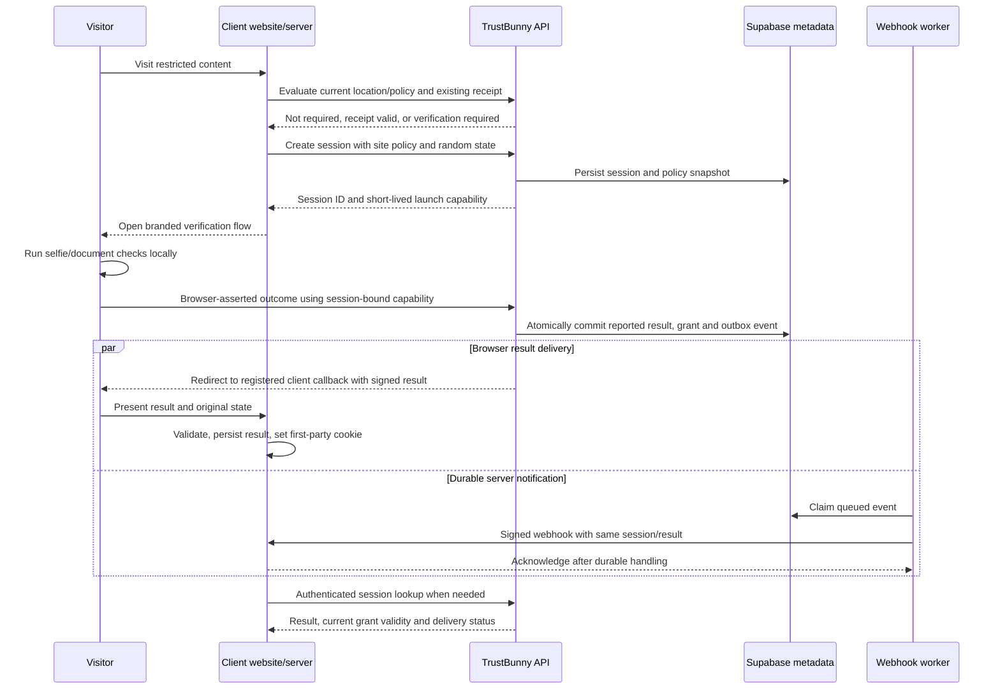

# TrustBunny product and implementation plan

Draft: 2026-09-18. Based on the owner's requirements and [the repository review](./SYSTEM_REVIEW.md). Confirmed product choices here supersede recommendations in that earlier code review. This is a design proposal, not an implemented API or deployed schema. Product choices marked proposed remain open for discussion.

## Product contract

TrustBunny lets a website request an age check, receive a verifiable outcome, and remember that outcome without TrustBunny retaining the visitor's identity documents or identifying verification data. The client website owns its access decision and any mapping from a verification session to its own users.

One completed verification produces one durable result, available through three independent channels:

1. A signed result in a redirect URL, allowing the client's server to grant access immediately.
2. An authenticated webhook, allowing the client to persist/reconcile the result even if the visitor closes the browser.
3. An authenticated session API, allowing checks and recovery when a redirect or webhook is missed.

The client can maintain both a first-party verification cookie and its own database record. The JavaScript SDK provides a branded, geography-aware age gate. A future WordPress plugin supplies the same behavior plus server-side content enforcement.

## Decisions and working assumptions

| Decision | Proposed position | Status |
| --- | --- | --- |
| Verification execution and assurance | Browser-only verification with known tampering limitations | Owner confirmed |
| Reuse scope | Across participating TrustBunny clients, subject to the destination site's current policy | Owner confirmed |
| Unknown location | Each client explicitly chooses its fallback behavior | Owner confirmed |
| Meaning of privacy promise | No retained visitor identity/biometric/document data; explicitly allow limited operational metadata | Owner requirement; details below |
| Client administrator information | Treat account-holder login/contact information separately from visitor verification data | Assumption to confirm before account onboarding |
| Lifetimes and retention | Finite defaults and caps, configurable within supported policy limits | Proposed values below; not adopted legal requirements |
| Hosting | Keep Node/TypeScript for API and workers; use the existing Supabase project for durable metadata and account access | Proposed; no platform migration needed to begin |

The first version keeps face inference and document OCR entirely in the browser. Verification images, OCR text and biometric descriptors do not leave the visitor's device through the application flow. Only the bounded outcome/method/threshold metadata is reported to TrustBunny.

Record and expose the assurance class `browser_asserted`. The server can authenticate the session, enforce its policy/configuration, restrict who may complete it, and sign the recorded result, but cannot prove an unmodified browser performed the age check honestly. A signed redirect authenticates TrustBunny's recorded assertion; it does not remove this accepted limitation. Reused results preserve the same assurance class. Do not market this version as tamper-resistant or independently identity-verified. A future higher-assurance method can use the same delivery contract without being a prerequisite for this release.

## End-to-end behavior



The webhook is generated after the result is committed, but network delivery may occur before or after the browser redirect. Integrators must handle either order and duplicates. The redirect, webhook and API cannot disagree about the committed result; current grant validity may subsequently expire or be revoked.

## Client account and site settings

An account contains authorized administrators and one or more registered sites. Each site has:

- Verified exact origins; separate test and live configuration and API credentials.
- Branding: logo, colors, text and permitted language choices, using structured settings rather than arbitrary injected HTML/JavaScript.
- Registered callback paths and webhook endpoints, HTTPS in live mode. No visitor-controlled open redirects or callback destinations.
- Versioned geography rules: country/subdivision, required age threshold, accepted methods/assurance, receipt validity, unknown-location behavior and effective dates.
- Verification cookie lifetime, reuse scope, recheck cadence, and outage behavior.
- Integration mode, key rotation/revocation controls, minimal usage summaries and webhook delivery diagnostics.

Treat this as a configurable rules engine. A future maintained regulatory rules library can suggest defaults, but the initial dashboard should not claim automatic legal coverage. Policy changes create a new version. In-flight sessions keep an immutable snapshot for audit; access decisions also check whether the result meets the currently effective rule.

Location means coarse country and state/province where available. TrustBunny should observe the visitor's connection at a trusted edge/API endpoint, or accept a visitor address from an authenticated client backend with a correctly configured proxy chain. A server-to-server request's network IP is normally the client's server, not the visitor. Never use a freely supplied browser country/timezone as authoritative location. IP geography is approximate; missing/uncertain results use the client's chosen fallback: require verification, allow without verification, or deny pending resolution. Make that choice explicit at setup and version/audit it. Allowing access because location is unknown does not produce an age-verified result. Do not rigidly bind a long-lived grant to one IP address.

## Integration modes

| Mode | Client setup | TrustBunny/client behavior |
| --- | --- | --- |
| Signed redirect + webhook + API | Server API key, callback handler, webhook endpoint | Recommended full integration; immediate local signature validation, durable notification and lookup fallback |
| One-time code redirect | Callback handler plus authenticated code exchange | Less result data in the URL and centrally enforced redemption; one extra server request |
| JavaScript gate | Public site ID and script tag on a registered origin | Branded overlay, geography rules, verification UI and signed first-party receipt |
| JavaScript + backend | Script plus same-origin status/completion endpoints | Same UI with server-protected content and HttpOnly cookie |
| WordPress plugin | Install plugin, connect site, choose policy/content scope | SDK plus PHP callbacks, cookie handling, webhooks, reconciliation and content enforcement |

A script-only overlay controls presentation. It cannot protect HTML, media or API responses already sent to the browser, and can be bypassed if JavaScript is disabled or modified. Offer server/edge enforcement for clients needing actual access control. Make this distinction visible when the client chooses its installation method.

## Proposed API contract

These route names are proposed for version 1:

| Endpoint | Caller/authentication | Purpose |
| --- | --- | --- |
| `POST /v1/verification-sessions` | Site-scoped server secret + idempotency key | Create a session |
| `GET /v1/verification-sessions/{id}` | Owning site's server secret | Read result and current validity |
| `POST /v1/result-exchanges` | Server secret + bound one-time code | Redeem a result code |
| `POST /v1/grants/{id}/revoke` | Authorized server/administrator | Revoke reusable access evidence |
| `GET /.well-known/jwks.json` | Public | Publish verification keys |
| `POST /v1/browser/bootstrap` | Public site ID, registered origin, abuse controls | Evaluate gate policy and start a narrowly scoped browser interaction |
| `POST /v1/browser/sessions/{id}/complete` | Bound browser session capability | Report browser-only outcome once, within the session's policy and lifetime |
| `POST /v1/browser/receipts/check` | Site-bound receipt and browser scope | Validate receipt against current visit policy |
| `POST /v1/browser/completions/exchange` | Session-bound one-time completion + browser proof | Obtain a site-scoped receipt after successful verification |
| `GET /continue` | Short-lived launch request plus first-party TrustBunny cookie when available | Evaluate network-wide reuse during a top-level TrustBunny visit |

The public site ID/anon Supabase key is never a server secret. A site ID alone cannot complete a session, choose weaker policies, enumerate sessions, read another visitor's metadata, or send callbacks to arbitrary URLs. A browser holding its session capability may report that session's outcome; that is the explicitly accepted assurance boundary. Browser code never writes result tables directly. Origin/CORS checks supplement abuse controls; they are not authentication for privileged operations. Browser launch/poll/completion capabilities are short-lived and restricted to one session. Use nonce/PKCE-style binding where code redemption occurs in the browser. Those capabilities bind a request to a session; they do not attest honest execution of the browser model.

An example server creation request:

```json
{
  "site_id": "site_example",
  "policy_id": "policy_default",
  "return_url_id": "return_main",
  "state": "random-unpredictable-value-bound-to-the-client-browser-session"
}
```

The client stores its user/order/content association locally using the returned session ID or random state. Do not accept arbitrary `userData`, email addresses, names, account IDs, DOBs or full browsing URLs. The selected policy/return URL must belong to the authenticated site. Duplicate idempotency keys return the same session; the same key with conflicting input returns a conflict.

### Signed redirect

```text
https://client.example/age/callback?tv_result=<signed-result>&state=<random-state>
```

The result is an asymmetrically signed assertion, not a plain `verified=true` parameter or base64-encoded boolean. Its minimum claims are issuer, intended site/audience, test/live environment, session ID, outcome, threshold satisfied, assurance/method class, policy ID/version, verification time, grant validity deadline, browser nonce binding, assertion ID, issue time and a short delivery expiry. Do not include exact age, DOB, IP, document attributes or a global subject identifier. Test assertions and reusable proofs cannot authorize live-site access.

The client server validates the signature with a pinned allowed algorithm and expected issuer/audience/type, checks expiry and its original pending browser state, and atomically consumes the nonce/assertion ID. It then saves its own record, sets its cookie and redirects to a clean URL. A completed-session replay in the same already-authorized client session can be handled idempotently; replay cannot create a new grant in a different browser session. URL callback tokens are signed but are not confidential.

Use rotating asymmetric keys and publish old verification keys until their issued credentials have expired. Keep token signing keys separate from webhook secrets and Supabase API/JWT credentials. The exact supported signing algorithm and library will be pinned in the implementation contract.

Protect callback pages with no-store/no-referrer behavior, query redaction, no analytics/third-party resources, and immediate cleanup of the URL. The optional one-time-code mode exchanges an opaque short-lived code using the client server's credentials and original session binding. API secrets and webhook credentials never belong in callback query parameters. These controls follow [JWT best practices](https://www.rfc-editor.org/rfc/rfc8725.html) and the relevant URL leakage/replay guidance in [RFC 9700](https://www.rfc-editor.org/rfc/rfc9700.html); TrustBunny need not implement a full OAuth authorization server to apply those principles.

### Webhook and API reconciliation

Write the final result/grant and outbox event in one database transaction. An independent worker claims events, sends authenticated HTTPS requests, retries with exponential backoff/jitter and records bounded delivery metadata. Use endpoint-specific signing secrets, a timestamp, raw-body signature, stable event ID across retries and versioned schemas. Do not follow arbitrary redirects or allow private/link-local destinations; validate DNS/network destinations at delivery as well as registration.

The client's handler checks signature and freshness, acknowledges only after durable acceptance, deduplicates event IDs and upserts its session record. Retries may carry a fresh delivery timestamp while preserving the original event time/ID. The delivery status is separate from the verification outcome. A verification can succeed while its webhook is pending or exhausted. This design follows established [webhook delivery practices](https://docs.stripe.com/webhooks).

The session API returns the same immutable outcome plus current grant validity and policy information. A session ID alone is not permission to read it. Use API fallback immediately for ambiguous callbacks, on a missing notification deadline, and during periodic reconciliation of pending client records. A browser completion event is a signal to validate, not an access authorization by itself. Revocation requires online rechecks or a defined maximum offline/cached validity period; offline signature checks cannot detect a newly revoked grant immediately.

## Cookies, embedded UI and reuse

Evaluate the current visit's location/policy before deciding whether an existing cookie is sufficient. Validate the receipt's signature, site, age threshold, assurance, age of verification, expiry and revocation/policy compatibility. Cookie presence alone never means success. A visitor in an unregulated location receives a `not_required` policy decision, not an age-verified result.

Use a first-party receipt on the client's site. TrustBunny cannot directly set cookies for an unrelated domain, and embedded third-party cookies are not a reliable foundation. [MDN documents domain restrictions](https://developer.mozilla.org/en-US/docs/Web/HTTP/Reference/Headers/Set-Cookie) and [cross-site cookie limitations](https://developer.mozilla.org/en-US/docs/Web/Privacy/Guides/Third-party_cookies).

- In a full integration, the client sets a host-only `Secure; HttpOnly; SameSite=Lax; Path=/` cookie, preferably referencing its own local verification record. The SDK uses a same-origin status endpoint because it cannot read HttpOnly cookies.
- In script-only mode, the SDK running on the client origin can set a JS-readable first-party cookie containing a signed, site-bound receipt. Validation uses the browser-scoped API. This remains presentation gating and is more exposed to browser script compromise.
- Reuse across participating clients is part of the first release. Keep each client's receipt scoped to that client site; use the separate first-party TrustBunny proof described below to issue a new destination-specific receipt.
- Cookie expiry cannot exceed the underlying grant deadline. Reading/refreshing the cookie never refreshes the original verification time. Clearing a client cookie can be recovered from the TrustBunny proof; clearing that proof requires a fresh check unless another qualifying authenticated record remains.
- An age grant is evidence of a past verification, not proof of the current visitor's civil identity. Shared devices, copied credentials and authentication to the client's own account need explicit product expectations.

The SDK should load early with a small footprint, fetch only public site configuration, evaluate policy, display an accessible branded gate when required, and defer heavy verification resources until needed. Support keyboard navigation, focus management, mobile layouts, cancellation/error recovery, multiple languages, and clear loading states. Isolate the verification UI from the host page and validate both exact origin and window source on messages. Provide top-level redirect fallback when embedded camera/storage behavior is unsuitable.

### Reuse across participating clients

After a browser check passes, set an opaque host-only `Secure; HttpOnly; SameSite=Lax` cookie on TrustBunny's own domain during a top-level TrustBunny visit. Store only its hash and a reference to an internal reusable proof: threshold satisfied, method/version, `browser_asserted` assurance, original verification time, expiry and revocation. Do not put identity details or biometric data in it.

When a visitor reaches another participating site:

1. Evaluate that site's current regional policy and local receipt first. If no check is required, do not contact the shared proof merely for tracking.
2. If a check is required and its local receipt is missing/insufficient, show the branded gate with a Continue action. Open TrustBunny as a top-level navigation; an explicitly user-initiated popup can be added with redirect fallback.
3. TrustBunny reads its own first-party proof cookie. This works without depending on iframe third-party cookie access. The first visit to a new site can therefore involve a brief redirect even when another age check is unnecessary; do not promise silent cross-site discovery.
4. Check the proof against the destination's threshold, permitted method/version, maximum proof age, expiry and revocation. An over-18 proof cannot satisfy an over-21 request. A stricter rule requires a new browser check.
5. If eligible, create a new session/result for the destination site with `source=reused` and new outward-facing IDs. Preserve the original `verified_at` and cap its expiry to the underlying proof and destination rule. Deliver the same signed redirect/webhook/API contract without repeating capture.
6. The destination installs its own local receipt. Never send the original site's name, original session ID, internal proof ID or shared cookie value to that destination.

This allows reuse without distributing a common visitor identifier to client sites. TrustBunny itself can associate the site-specific sessions through its internal proof reference and IP; this is limited pseudonymous linkage, not a promise of unlinkability. Restrict that relationship to reuse/revocation and retention needs rather than building a browsing-history product. A root-proof revocation invalidates derived grants at their next enforced online check; offline acceptance has the documented freshness limit.

Do not create automatic redirect loops if a browser blocks or removes cookies. Return an actionable gate state, allow a fresh check and cap continuation attempts. Shared proof creation/reuse must work when third-party cookies are disabled. In an embedded first-time verification, use a short-lived, one-use completion handoff through top-level TrustBunny to establish its HttpOnly cookie; an iframe cookie alone is insufficient.

Provide a Clear shared verification action on TrustBunny that revokes the proof and removes its cookie. Previously issued site receipts are invalidated according to the documented online recheck/freshness behavior. No visitor account or identity record is needed for this device-held proof management.

## Data model and privacy boundary

The visitor promise should be: **TrustBunny retains verification outcomes and limited operational metadata, not the visitor's identity, images or identity documents.** IP addresses and cookie/session identifiers can still constitute personal data; describe this as data minimization rather than complete anonymity. [ICO's guidance explicitly discusses IP addresses and cookie identifiers](https://ico.org.uk/for-organisations/uk-gdpr-guidance-and-resources/personal-information-what-is-it/what-is-personal-data/what-are-identifiers-and-related-factors/).

| Record | Data retained |
| --- | --- |
| Accounts and memberships | Tenant membership/roles; administrator auth handled separately from visitors |
| Sites and policies | Registered origins, callback paths, branding, coarse-geography rules, policy versions |
| API credentials | Identifier/prefix, one-way hash, scopes, expiry/revocation; no retrievable plaintext API secret |
| Verification sessions | Random ID, tenant/site, lifecycle, policy snapshot, timestamps, optional allowed IP, coarse location, session binding hashes |
| Verification results | Outcome, threshold met, method/assurance class, verification time, validity deadline, bounded non-identifying reason codes |
| Reusable proofs | Internal random ID, cookie-token hash, original session/result, threshold/method, original verification time, expiry/revocation; no visitor identity |
| Grants | Random site-scoped ID, destination result, restricted internal proof reference, issue/expiry/revocation metadata; no common proof ID in client responses |
| Verification events | Allowlisted lifecycle events and timestamp; no arbitrary diagnostic bodies |
| Webhook endpoints | Registered destination, encrypted/restricted signing-secret reference, secret version |
| Outbox/deliveries | Event/session ID, attempt count/time, status code and bounded error category; no full response bodies |
| Operational audit | Administrative action/actor references and minimal changes; no verification input capture |

Do not retain visitor names, emails, DOB/exact age, document numbers, addresses, photos, video/audio, OCR text, biometric templates/face descriptors or raw verification inputs. Do not introduce account-style global visitor identifiers beyond the bounded internal reusable-proof relationship necessary for the requested reuse/revocation. Account-owner contact/auth/billing data needs a separately documented scope; do not silently treat those people as anonymous visitors.

Store a normalized registered originating site, not unrestricted page paths, query strings or referrer history. Derive only needed coarse location; avoid GPS and precise coordinates. Use explicit schemas/field allowlists so integration metadata cannot accidentally become an identity-data channel.

The boundary applies to logs, traces, error reporting, replay tools, queues, caches, temporary files, crash dumps and backups as well as tables. In this browser-only release, keep input processing in browser memory, remove debug image/OCR capture, and prohibit session-replay/error-reporting tools from capturing verification inputs or DOM. Do not upload image inputs through either the API or Supabase. Permit only allowlisted scalar result fields on completion; reject extra fields and oversized bodies. Supabase documents invocation/log visibility, so its actual metadata capture and retention settings must be checked as part of deployment. [Supabase logging documentation](https://supabase.com/docs/guides/functions/logging).

Use Supabase tenant-scoped RLS for authorized dashboard reads. Browser/anon database roles cannot directly write results or outbox records. Backend code validates the session-bound browser submission, performs tenant checks and commits the explicitly browser-asserted result through bounded transactional functions. Only the TrustBunny service can resolve reusable proofs; client administrators cannot inspect another client's source verification or internal proof links. Keep IP metadata in a restricted area with shorter retention where possible. A service-role credential is server-only and does not replace application authorization checks.

### Lifecycle and proposed initial time limits

Keep four concepts separate:

- Session lifecycle: `created -> in_progress -> completed | expired | cancelled`.
- Completed outcome: `passed | not_passed | inconclusive`. A technical failure or inability to estimate age does not mean the visitor is underage.
- Grant status: `valid | expired | revoked`, additionally checked against current policy.
- Visit policy: `verification_required | not_required | location_unknown` resolved through the account's configured rule.

Each session has at most one immutable final result. Late browser submissions, duplicate callbacks and races cannot resurrect expired/cancelled sessions or overwrite completion. Retrying a terminal session starts a new session with an explicit relationship if needed. Reuse creates a new destination-site session/result and does not mutate the source result.

Proposed starting defaults, subject to product/policy review: session timeout 20 minutes; redirect/code delivery lifetime 2 minutes; shared TrustBunny proof and remember-browser lifetime up to 365 days; client receipt lifetime capped by the proof expiry and client-configured freshness; webhook retry window 24 hours; keyed IP-hash retention 7 days; minimal session/result metadata 90 days. A client's maximum verification age can require a new check sooner than the shared proof expiry. Receipt lifetime, audit retention and webhook retries are different clocks. Keep result records for at least the longest outstanding valid grant/reconciliation requirement, and reject configurations that violate that invariant. Define purge behavior for replicas/backups as well as live rows. Do not promise immediate deletion from historical backups before selecting and checking the hosting retention settings.

## MVP boundaries and implementation sequence

| Milestone | Deliverable | Acceptance condition |
| --- | --- | --- |
| 0. Browser-check and delivery contracts | Specify browser-only assurance, retained fields, policy semantics and API/claim schemas | No verification inputs leave the device; accepted tampering limitation and test fixtures documented |
| 1. Durable backend | Supabase migrations/RLS, tenant/site keys, state machine, session creation/read/completion API | A client can create and retrieve a session; restart does not lose it; cross-tenant access and completion without the correct session capability fail |
| 2. Delivery and client example | Signed redirect and code mode, key publication, outbox worker, signed webhooks, reconciliation | One sample client grants access from a valid redirect and converges on the same record despite webhook loss/reordering |
| 3. Reuse, client setup and JavaScript gate | Minimal account UI, domains/policies/branding, public SDK, shared TrustBunny proof and site-specific receipts | Two independent sites can reuse a qualifying browser check with third-party cookies disabled; stricter policies trigger another check; per-client unknown-location choices work |
| 4. Pilot and documentation | Node/PHP quickstarts, generated API reference, webhook/cookie recipes, test/live sandbox | Another developer integrates without undocumented assistance; error and recovery paths are exercised |
| 5. WordPress | Plugin using the stable public contracts | Server gating, callbacks, plugin settings and supported cache configurations pass integration tests |

Documentation begins with the first API slice; the larger documentation library grows alongside the SDK/plugin. Billing sophistication, a managed regulatory library, higher-assurance verification methods, many framework plugins and elaborate analytics are later work. Cross-client reusable verification is in scope for the initial product.

Reuse the repository's verification UI, document templates and models where they survive evaluation. Replace the memory-only session layer, default shared encryption format, unconditionally accepted completion modes, open callback configuration and third-party-cookie-dependent checks. The replacement completion endpoint deliberately retains browser-reported outcomes, with explicit assurance labeling and session/policy/replay controls. Keep the old demo isolated from live partner endpoints. No broad Next.js rewrite is required for the initial service.

## WordPress and documentation plan

The WordPress plugin should connect a site using server-held scoped credentials, configure protected content/policy/branding, create verification sessions, validate redirects, set HttpOnly first-party cookies, process signed webhooks and reconcile delayed results. It must protect applicable REST feeds/downloads as well as page templates and account for full-page/CDN caches so an authorized response never becomes a public cached response. Scope supported content/cache integrations explicitly; do not claim a template-only overlay protects every WordPress delivery path.

Required documentation: five-minute JS install; server redirect quickstart; signature validation and key rotation; webhook verification/retries/idempotency; API lookup/reconciliation; policy and cookie behavior; privacy/data retention; accessibility and browser troubleshooting; Node/PHP examples; test/live migration; WordPress setup and cache compatibility; versioning/changelog. Publish generated OpenAPI from the implemented contract and runnable contract tests/examples to avoid documentation drift.

## Verification and release criteria

- Successful redirect grants access after verification of signature/site/state/expiry; altered claims, wrong audience, expired proof and cross-session replay fail.
- Webhook loss, duplicates, slow responses, worker restart and reversed arrival order converge to one client record via retry/API recovery.
- Concurrent completion, cancellation, expiry and browser retries result in exactly one valid terminal transition and outbox event.
- Missing, forged, stale, revoked or insufficient cookies do not satisfy the gate. `not_required` never turns into an age-verification credential.
- New geography and stricter policy rules are evaluated against previous receipts; unknown geography and service outage follow explicit settings.
- Cross-tenant access, public-site credential misuse, callback SSRF/open redirects and forged browser messages fail.
- Prohibited data do not appear in tables, objects, logs, queues, traces or failure artifacts. Retention jobs and backup behavior match the documented promise.
- SDK behavior is checked with third-party cookies disabled and on supported desktop/mobile browsers. Accessibility and restricted-content cache bypasses are exercised.
- Cross-client reuse produces fresh client-specific IDs and no shared proof ID disclosure; stricter thresholds, deleted cookies, blocked popups, root revocation and redirect-loop prevention are tested.
- Browser-method evaluation measures false acceptance/rejection, inconclusive outcomes, presentation attacks, latency and fairness using appropriately consented datasets. Tests must separately record that a modified browser can falsify its own outcome; no test/report may imply this accepted limitation was eliminated by token signing.

The first concrete engineering slice should be one authenticated client, one site, one policy, one browser-based verification method, one signed redirect, one retried webhook and one API lookup. Then add a second independent client to prove cross-client reuse with site-specific receipts before expanding the dashboard, theme system or plugin ecosystem.


## Implementation status — September 18, 2026

The first local product implementation now includes the branded homepage, client accounts/dashboard, site settings, API keys, Supabase persistence, browser-only verification adapter, signed redirects and single-use code exchange, current-status API, signed webhook outbox/retries, revocation events, browser embed, and optional discoverable visitor passkeys with recovery codes. A Node server-integration reference and WordPress embed plugin are included. Production hosting, native-device acceptance testing, operating-company legal details, and the further operational features documented in OPERATIONS.md remain launch work. The WordPress embed does not enforce server-side access control.
