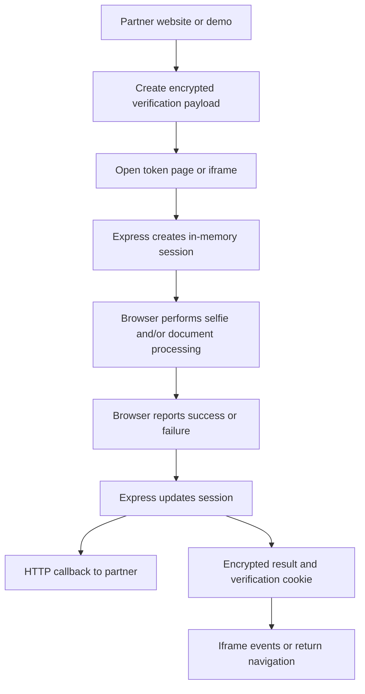

# TrustBunny system review

Historical review of the original TrustVerify application, before the product implementation and TrustBunny rebrand.

Reviewed 2026-09-18 at commit `963ca20`. This describes the current repository and the connected Supabase project, followed by proposed next steps. No application changes or database migrations were made during the review.

## Current product

TrustBunny is a fork of the go.cam age-verification demo. It provides a hosted verification screen that another website can open in a separate tab or embed in an iframe. The home page demonstrates integration, callback configuration, and theme colors. It is not yet a merchant dashboard or an account-based SaaS application.

The source implements two verification methods:

- **Selfie age estimation:** face-api.js runs in the visitor's browser. The default flow collects five valid age estimates, removes outliers, compares face descriptors across images, and accepts an estimated average age of at least 25 after an expression-change check. Otherwise it offers document verification when enabled. The expression check asks the user to switch between smiling and not smiling; virtual-camera detection uses device-label heuristics.
- **Document age extraction:** the visitor selects a supported country/state/document and captures or loads an image. Face detection locates the portrait, layout rules locate the birth-date area, and Tesseract extracts text. Regular expressions parse the date and derive age. The combined selfie/document flow compares document and selfie face descriptors. Standalone document mode skips that comparison.

The document configuration contains 37 country entries, with differing coverage of identity cards, passports, driver's licenses, and regional layouts. Some document types are explicitly unimplemented. These rules are templates for OCR and face matching; the reviewed implementation does not establish document authenticity through an issuer check or an independent document-verification service.

The hard-coded age thresholds are implementation details, not verified statements of current legal requirements. No assessment of model accuracy, demographic performance, legal suitability, or certification applicability was performed.

## Technology and source map

| Area | Implementation | Starting point |
| --- | --- | --- |
| Server | Node, Express 4, TypeScript, Twig | `source/backend/app/app.ts` |
| Configuration | dotenv, encryption, timeouts, age thresholds | `source/backend/app/config/index.ts` |
| Request creation and demo integration | Express routes and jQuery | `source/backend/app/route/index.ts`, `source/frontend/js/app/common.js/01-page/01-home.ts` |
| Verification entry | token routes and rendered configuration | `source/backend/app/route/token.ts` |
| Session lifecycle | in-memory objects | `source/backend/app/storage/session.ts`, `payload.ts` |
| Result acceptance | success/fail/polling endpoints | `source/backend/app/route/result.ts` |
| Browser workflow | TypeScript namespaces and custom events | `source/frontend/js/app/avsFactory.js/` |
| Browser utilities and models | face-api.js, Tesseract, webcam/canvas helpers | `source/frontend/js/app/avs.js/` |
| Document templates | country/state/layout/regex configuration | `source/frontend/js/app/avs.js/config/scanId.ts` |
| Iframe integration | postMessage SDK and cookie check | `source/frontend/js/app/avsFactoryIframeSdk.js/`, `avsFactoryIframeCheck.js/` |
| Views | server-rendered HTML | `app/frontend/views/` |
| Styles | Sass | `source/frontend/css/` |
| Build | Gulp compiles TypeScript, concatenates browser scripts, compiles Sass | `script/gulpfile.js` |
| Integrator examples | Node and PHP SDK/demo applications | `example/nodejs/`, `example/php/` |
| Research artifacts | age-estimation benchmark notebooks | `benchmark/` |

`app/backend/` and `app/frontend/static/js/app/` contain committed compiled JavaScript. Development edits should target `source/` and rebuild the relevant output. Views are edited directly under `app/frontend/views/`.

The project is not Next.js. The supplied `NEXT_PUBLIC_SUPABASE_*` names currently have no consumer in the codebase.

## Request and result lifecycle

1. The demo posts colors, a callback URL, and the demo URL to `/getVerificationPayloadAndUrl`. The server adds user-agent/IP metadata, demo user ID `0`, and hard-coded US/TX location data. It returns an AES-CBC-encrypted payload and redirect/iframe URLs. The example SDKs can also construct payloads using the shared encryption key.
2. `/token?d=...` or `/token/iframeRender?d=...` decrypts the payload and creates an application session. The Express cookie session holds the application session ID, access time, payload, and success/failure tokens. Both tokens are supplied to the browser in base64-encoded page configuration.
3. The browser loads local model assets and presents verification choices and terms. The token route currently supplies a separate hard-coded `FR` country hint.
4. Browser code processes webcam/document images and posts a result to `/result/success` or `/result/fail`.
5. The server checks a step value and a 20-minute time limit, conditionally checks the token, updates memory, and asynchronously posts result metadata to the configured callback URL.
6. Success returns an encrypted result payload and sets `isAgeVerified`, configured for 30 days. The iframe SDK uses browser messages to communicate status. A receiving application can call `/validateVerificationPayload` to decrypt/check a success payload. `/result/isSuccess` polls the in-memory result for the original payload, including for the QR/other-device continuation flow.

| Route | Purpose |
| --- | --- |
| `GET /` | Demo/integration page |
| `POST /getVerificationPayloadAndUrl` | Create request payload and URLs |
| `GET /token` | Standalone verification |
| `GET /token/iframeCheck` | Check existence of verification cookie |
| `GET /token/iframeRender` | Embedded verification |
| `POST /result/success` | Accept a successful browser result |
| `POST /result/fail` | Accept a failed browser result |
| `POST /result/isSuccess` | Poll original-payload status |
| `POST /validateVerificationPayload` | Decrypt/check result state |
| `POST /callback` | Demo callback receiver writing to disk |

## Data handling

In the reviewed flow, face inference, OCR, face descriptors, document canvases, and age calculations are handled in the browser. Models and OCR files are served from the repository; model/OCR assets under `appFiles` total approximately 36 MB. Google Fonts is an external page dependency. Camera use is implemented through `getUserMedia`; the class named WebRTC does not by itself imply an external video-processing service.

The server does receive and hold metadata: IP, user agent, partner/user data, website hostname, callback URL, result state, verification step, and selected document country/state/type. The callback includes IP and user/verification metadata. Morgan logs requests, including URL paths/query strings. Therefore, the UI's blanket statement that no personal data is transmitted is broader than the behavior shown in the code, even though the reviewed image-processing path does not upload images to the backend.

Application sessions and used-payload tracking are JavaScript objects with no persistence or pruning. Express also uses its default in-memory session store and generates a session-signing secret at startup. Restarting the server loses active session state; separate server instances do not share it.

## Supabase: verified current state

Read-only inspection through the connected Supabase tools found:

- Original database project name: `TrustVerify`, reference `lecrhouejepvpdvrpjrb`.
- API URL: `https://lecrhouejepvpdvrpjrb.supabase.co`.
- Status: `ACTIVE_HEALTHY`; region `us-east-1`; PostgreSQL major version 15.
- No tables in `public`; an additional information-schema query found no application tables outside the excluded Supabase/system schemas.
- No recorded Supabase migrations and no deployed Edge Functions.
- The repository has no Supabase SDK, client initialization, migrations, or database access layer.

These results came from the authenticated connector, not a connectivity test of the supplied anon key. The supplied key was not copied into tracked files or used to make database writes. Auth-user records and stored user files were not inspected.

The anon key is intended for public client access constrained by database grants and Row Level Security. It is not a privileged database-management credential. See [Supabase's RLS documentation](https://supabase.com/docs/guides/database/postgres/row-level-security). Adding environment variables alone would not connect this application.

## Confirmed defects and architectural gaps

### 1. Browser-reported success is not independently verified

`source/backend/app/route/result.ts:53` only checks the success token when the client-supplied `deviceLocationVerification` equals `0`. An omitted value or value `1` skips that check. An isolated handler check with a valid synthetic session confirmed it reaches the success storage call without a token in both cases; mode `0` rejects an omitted token.

Even when the token is checked, `source/backend/app/route/token.ts:91` sends it to the browser before verification. The server receives no independently verifiable inference evidence and accepts any recognized step ID, including the initial page. Fixing the conditional alone cannot make a browser-controlled result authoritative.

### 2. Expiry and reuse handling is incorrect

`source/backend/app/storage/session.ts:79` stores the payload before asking whether it was already stored, so that check always succeeds. `source/backend/app/storage/payload.ts:32` reports expiration when `created + lifetime > now`, reversing the expected comparison. It also uses first-use time rather than the encrypted creation timestamp.

Isolated checks confirmed that a newly stored payload is marked expired and becomes unexpired after the lifetime. A fresh application session receives the expired state. The token renderer does not reject these session states, so the UI can still open. Terminal-state transitions also are not enforced in `end()`.

### 3. Callback delivery needs authentication, destination constraints, and reliability

The demo accepts a user-supplied callback URL and `storage/session.ts:146` posts to it from the server without a destination allowlist. This creates a server-side request-forgery risk. Callbacks have no application-level signature, retry queue, idempotency key, or explicit request timeout in this code. Success does not depend on successful callback delivery.

The demo receiver writes to `log/callback.log`, but the `log` directory is absent in the checked-out workspace. The callback handler returns a structured error when appending fails; the sending code logs success for a resolved HTTP response without checking its response body.

### 4. Payload and message trust need strengthening

The payload format uses AES-256-CBC without a MAC/authentication tag and ships a static default encryption key. `/validateVerificationPayload` checks decrypted success state without explicit result expiry, audience/partner binding, or revocation lookup. An encrypted result is not evidence that the browser performed the checks honestly.

Browser messaging also needs review: `avs.js/helper/postMessage.ts` and the iframe cookie-check listener do not validate message origin/source, while the SDK receiver compares only hostname. Several responses use a wildcard target origin. The cookie-check page treats cookie existence as verification until the integration performs a separate validation step.

### 5. Configuration and product boundaries are still demo-oriented

Location hints are hard-coded and inconsistent between request creation and token rendering. `ENABLE_FRONTEND_DEBUG=false` is loaded as the string `"false"`, not a boolean; the config check confirmed that type/value. Session cookies and verification cookies use different security settings. Error handling around malformed URLs/payload decryption is incomplete.

The interface retains upstream branding, terms, and certification statements. Their applicability to TrustBunny was not established by this review. There is no merchant authentication, organization membership, API-key management, persistent audit history, billing, or administration UI in the reviewed application.

## Proposed role for Supabase — not implemented

Supabase can provide durable application data and dashboard authentication. A reasonable initial model is organizations, memberships, registered partner sites, hashed API credentials, verification sessions, append-only verification events, and webhook delivery attempts. Persist metadata and outcomes by default; avoid adding image/document storage merely because storage is available.

Browser/dashboard reads should be scoped to organization membership using grants and RLS. Final verification outcomes and webhook records should be written through trusted server code, not by permitting anonymous clients to set a success field. Browser authentication and verification-subject identity are separate concerns.

Before designing the final tables, decide what evidence will authorize a successful verification. Options require a separate design evaluation: independently validated server processing, a trusted provider result, or another explicit attestation mechanism. Merely storing the current browser assertion in Postgres would preserve the existing trust problem.

Suggested implementation order:

1. Define result authority, partner identity, required age policy, retention, and callback contract.
2. Correct result authorization, session transitions, expiry/replay handling, payload authentication, callback destinations, and message validation.
3. Add Supabase migrations, tenant isolation, durable sessions/events, and reliable callback delivery.
4. Build partner onboarding/dashboard and replace upstream branding/content.
5. Validate full camera/document flows across browsers with consented test fixtures and measure verification quality.

## Validation performed and limits

- The local dev server is available at `http://localhost:3300` using `npm run startDev`.
- The home page rendered successfully. An isolated browser tab exercised iframe initialization: model resources loaded, integration events fired, and the verification start screen appeared with no captured browser warnings/errors. The original preview tab was preserved.
- Both `tsc --noEmit -p source/backend/tsconfig.json` and `tsc --noEmit -p source/frontend/js/tsconfig.json` passed.
- Isolated checks exercised compiled payload/session classes and result handlers using synthetic inputs and stubbed storage; no callbacks or Supabase writes occurred in those checks.
- No actual camera capture, identity-document processing, terms acceptance, or age-verification completion was performed. The review does not establish end-to-end accuracy or production readiness.
- No application test script is declared in `package.json`; benchmark notebooks are not a regression test suite.

For development, `npm run startDev` watches compiled backend JavaScript. TypeScript/Sass source changes require `npm run build` or the appropriate build/watch script; the server watcher alone does not compile source changes. The README targets Node 20, while this local run uses Node 26. Source type checks passed, but a full rebuild/runtime compatibility matrix was not part of this review.
